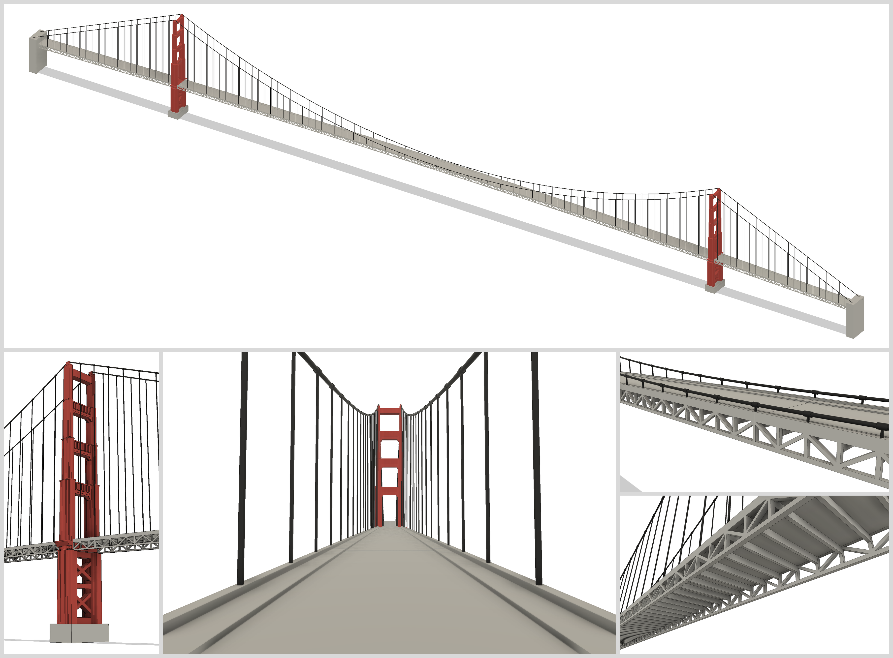
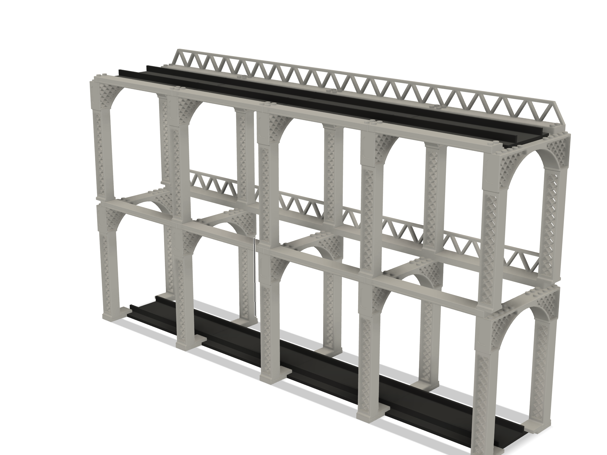

# cad-apprentice

**Human-friendly CAD, fast.** An AI agent designs a part with you in Autodesk Fusion and gets it
ready for 3D printing. You ask, it builds and shows you pictures, you say what to change, iteration
after iteration, until you approve.

It is a skill for AI agents, with a Python library and a set of rules, listed in [What's in it](#whats-in-it). The
agent's rules are in [fusion/rules.md](fusion/rules.md).

**Contents:** [Key features](#key-features) · [How to start](#how-to-start) · [Demos](#demo-golden-gate-bridge) · [What's in it](#whats-in-it) ·
[3D printing](#3d-printing) · [Supported steps](#supported-steps) · [Known limits](#known-limits) ·
[Testing your design](#testing-your-design) ·
[Prerequisites, permissions and data](#prerequisites-permissions-and-data) ·
[Contributing](#contributing) · [License and notices](#license-and-notices)

## Key features

### Human-friendly

- **Tidy timeline.** Every sketch, feature and body has a name. Each part is its own component with
  its own timeline group.
- **Respect for manual changes.** You can edit the design in Fusion between runs. The agent keeps
  your features, parameter values, names and joints.
- **Version history.** Each iteration is a saved version in Fusion, with a note on what changed. If
  a feature breaks, the design goes back to the last saved version.
- **3D printing automation.** The agent makes a 3MF project for your slicer and swaps in the new
  parts after later changes ([3D printing](#3d-printing)).

### Fast robust designs

- **Parametric.** Every size is a named parameter or an expression.
- **Fully constrained sketches.** Every sketch is fully constrained. Constraints tie sketch objects
  to each other where they can.
- **Best practices.** The rules say how to build features that survive parameter changes, print
  well and recompute fast in Fusion ([fusion/rules.md](fusion/rules.md)).
- **Tests for parameters.** The agent tries each parameter across its range and checks that the
  design builds with no warnings. Each value is set, checked and put back, with no rebuild
  ([Testing your design](#testing-your-design)).

### Faster agentic work

- **Workflow with fewer interruptions.** Fast task clarification with sketches at the beginning.
  Then longer autonomous design runs, and feedback cycles with images. Testing and optimization at
  the end are fully autonomous.
- **Autonomous Fusion control.** A runner add-in starts each run in Fusion in the background, even
  behind a locked screen. With it, the agent takes over the screen less often, only to click in
  Fusion, and gives it back right away. An agent that can control the screen asks for permission
  once per session.
- **Fast execution modes.** The agent chooses between an incremental update and a clean rebuild.
  An incremental update redoes only the steps that changed. For large changes, building from scratch
  is faster.
- **Fail fast.** Fusion work is slow, so the design goes through quick checks first. Scripts read
  the build script in seconds and stop the run on a mistake that would fail it halfway.
- **Observability.** The log times each Fusion operation. The agent spots a stalled run and
  reworks the slowest design steps.
- **Adaptability.** When a design needs a step the library doesn't have, the agent adds it to the
  library ([Contributing](#contributing)).

## How to start

You need Autodesk Fusion and an AI coding agent that can run commands: Claude Code, Codex or
another.

The skill was tested on a Mac only. The logic should work anywhere, so you can ask your agent to
tune it for Windows. If you do, please consider contributing back ([Contributing](#contributing)).

Give your agent these prompts in order.

1. **Set up the skill, once.**

   **Claude Code:** install the skill as a plugin, straight from this GitHub repository. Claude
   Code then uses it for every CAD and Fusion 360 task, so you don't need to change your guidelines.

   ```bash
   claude plugin marketplace add heavior/cad-apprentice
   claude plugin install cad-apprentice@cad-apprentice
   ```

   Then:

   ```
   Set up cad-apprentice for my Fusion 360 and check that it works.
   ```

   **Codex and other agents:**

   ```
   Clone https://github.com/heavior/cad-apprentice and read all the .md files in it. Add to your
   main guidelines that every CAD and Fusion 360 task uses this skill's workflow, rules and library.
   Then set up the library and the runner add-in for my Fusion 360, and check that they work.
   ```

2. **Describe the design.** Attach photos of a hand-drawn sketch, notes or reference pictures.

   ```
   Using the attached images, design me a <what it is, what it holds or fits, its main sizes>.
   Follow the design workflow and show me your understanding first.
   ```

3. **Confirm the agent understood.** It sends a picture of its idea and its questions, before any
   CAD. Answer the questions and correct the picture until it matches what you want. Then:

   ```
   Now create the Fusion 360 design for me.
   ```

   Before the first run, an agent that can control the screen asks once for that and to keep the
   laptop awake. Click Allow. The runner add-in starts runs without the screen. The agent needs the
   screen only when the add-in doesn't answer, to start the run from Fusion's Scripts dialog itself.
   The laptop has to stay awake for runs to go on; if your agent can't keep it awake, do it yourself.
   The agent writes a build script, runs it in Fusion in the background and sends you pictures of
   the saved design.

4. **Iterate.** Each run comes with pictures. Reply with what to change, draw your notes right on
   the picture, or edit the design in Fusion yourself. Each iteration is saved as a new version. The
   agent exports and prints nothing until you say the design is right.

5. **Optional: make the design robust.**

   ```
   Follow the parameter testing guidelines, run the test, and debug the design as needed.
   ```

   The agent fixes what breaks, or narrows a range no one will use, and shows you what it chose
   ([Testing your design](#testing-your-design)).

6. **Optional: get it ready to print.**

   ```
   Make the 3D print project. Follow the 3D printing guidelines.
   ```

   The agent builds a 3MF project for your slicer and keeps it up to date after later changes
   ([3D printing](#3d-printing)).

## Demo: Golden Gate bridge



A parametric suspension bridge with towers after the Golden Gate's. Notes and all iterations are in
the [project README](demos/suspension-bridge/README.md).

| | |
| --- | --- |
| Agent | Claude Code, Opus 5.5, high reasoning effort |
| Agent's working time | about 3.4 h |
| Iterations | 4 |
| Design | 35 sketches, 80 features, 76 user parameters, 6 unique components, 8 in all |

## Demo: LEGO® train bridge



[Brick Train Bridge on MakerWorld](https://makerworld.com/en/models/3613953-brick-train-bridge-stackable-and-customizable).

| | |
| --- | --- |
| Design | 56 sketches, 151 features, 96 user parameters, 19 components |

## What's in it

| Part | What it gives the agent | Where |
| --- | --- | --- |
| The library | builds the design from a script on the first run and updates it step by step on later runs ("upsert": update a step if it exists, insert it if it doesn't); names everything, saves versions, checks every feature | [fusion/lib/cad_apprentice/](fusion/lib/cad_apprentice/) |
| Rules for designing in Fusion | 31 rules: working with you, sketches, parameters, the timeline, lessons from designs that broke | [fusion/rules.md](fusion/rules.md) |
| Rules for 3D print prep | which parts to print, STLs, a filament for each, the Bambu Studio project | [3dprinting/rules.md](3dprinting/rules.md) |
| Runner add-in | lets the agent start a Fusion script without clicking ▶ for you | [fusion/runner/](fusion/runner/) |
| `fusion_outputs.py` | starts a new design from the template, checks a script, runs it, prints the log as it grows, collects pictures and STLs | [fusion_outputs.py](fusion/tools/fusion_outputs.py) |
| Checks | `precheck.py` reads a script before Fusion does; `check_slow.py` finds slow Fusion calls with no timer, and runs after every edit the agent makes | [precheck.py](fusion/lib/cad_apprentice/precheck.py), [check_slow.py](fusion/lib/cad_apprentice/check_slow.py) |
| Picture tools | gallery pictures of a saved design, and trimming them | [gallery_shots.py](fusion/tools/gallery_shots.py), [trim_picture.py](fusion/tools/trim_picture.py) |
| 3MF tools | make the Bambu Studio project, and put new meshes into it | [build_3mf.py](3dprinting/build_3mf.py), [update_3mf.py](3dprinting/update_3mf.py) |
| Skill files | tell the agent to use the kit for every CAD and Fusion 360 task: designing, setup, the parameter test, print prep and fixing a failed run; the plugin installs them in Claude Code | [cad-apprentice](skills/cad-apprentice/SKILL.md), [setup](skills/setup/SKILL.md), [test](skills/test/SKILL.md), [print](skills/print/SKILL.md), [fix](skills/fix/SKILL.md) |

Every tool, its commands and options: [fusion/tools/README.md](fusion/tools/README.md).

## 3D printing

Once you approve the design, the agent can build a 3D print project for it, a
[3MF](https://3mf.io/) file. Bambu Studio,
OrcaSlicer, PrusaSlicer and UltiMaker Cura all open 3MF, but so far the skill has been tested only with
Bambu Studio.

The agent keeps that project up to date between iterations. You change what you like in your
slicer: settings, scale, how each part is turned, extra copies. After the next design change, the
agent swaps in the new parts and keeps all of that. No exporting and re-importing by hand.

**Test prints.** Before the full print, the agent suggests small parts to test what's risky: a fit,
a tolerance, a thin wall. When the right value isn't known yet, it offers a calibration piece that
tries several values side by side. You decide whether to make them.

The agent's steps are in [3dprinting/rules.md](3dprinting/rules.md).

## Supported steps

- **Objects:** parameter, component, timeline group, sketch.
- **Construction:** plane, offset plane, plane at an angle, midplane, axis, point.
- **Features:** extrude (also thin), revolve, sweep, pipe, loft, hole (simple, counterbore,
  countersink), combine, fillet (also chord and variable), chamfer, shell, split body, remove,
  base feature.
- **Moving and copying:** move, rotate, copy, scale, rectangular pattern, circular pattern, pattern
  along a path, mirror.
- **Joints:** joint (rigid, revolute, slider), as-built joint.
- **Anything else:** a custom step, and taking over a feature you made by hand.

The full list with every option is in [lib/README.md](fusion/lib/README.md).

## Known limits

- **A key used twice** is caught by the read-ahead check when it's written in the source. A key
  built at run time is caught by `step()` at its second use, after the first one ran. The run then
  stops and goes back, so nothing in the design changes (scenario A5 tests this).
- **No-change runs and groups:** opening and closing groups can leave the tab marked as changed, so
  the next run that changes something saves one extra restore point.
- **Split bodies:** a Combine whose tools are pieces of a split body breaks for good when a
  parameter changes the pieces, and putting the value back doesn't heal it. Keep bodies whole: cut,
  then Join a fill, instead of splitting.
- **Big updates are slow.** Editing most steps of a big design in place takes longer than a
  rebuild. Use `clean` mode for those iterations.
- **Tested on a Mac only.** Nothing here was run on Windows yet.

## Testing your design

Each parameter that is a plain value, not a formula, gets a range and a step in the build script:
the lowest and highest values it is meant to take, and how far apart the values are. The agent
guesses each range when it makes the parameter, on the wide side, and keeps working. When the
iteration is ready, it shows you the new ranges to review. Set a range yourself if you need the
design to reach certain values. The same ranges and steps are the slider limits on MakerWorld's
Customize page.

The parameter test sets parameters to values from their ranges and checks that the design still
builds with no errors or warnings. Then it puts the values back and checks the design comes back
the same.

The test is built to fail fast. It runs in stages, quick ones first, and stops after the first
stage that fails, so a broken design shows up in a few trials, not at the end of a long test.

1. **Ends:** each parameter alone at its lowest and its highest value. When an end fails, the test
   finds the last value that works, so you learn which values each parameter survives.
2. **Steps:** each parameter one step up and one step down from its current value.
3. **Extremes:** all parameters at their lowest values at once, then all at their highest.
4. **Random sets,** when you ask: each run picks a random value for every parameter at once. This
   finds mixes the other stages never try. The agent offers it once the first three pass.

A full test can take a while. Ask your agent to run it, so it can find what breaks and improve the
design:

```
Run the parameter test on my design and fix what fails.
```

To test only some parameters: "Test the `wall` and `height` parameters now."

After the first three stages pass: "Run 50 random sets of parameters."

When an end of a range fails, the agent decides. Values you would reasonably pick must work, so it
fixes the design for those. For edge cases no one will use, it narrows the range rather than make
the design more complex. A range you set yourself it doesn't narrow without asking. Either way it
shows you what it chose with the next iteration.

## Prerequisites, permissions and data

The kit has no server and sends nothing anywhere itself ([PRIVACY.md](PRIVACY.md)). Your agent runs
everything below on your Mac, and only for the design you asked for.

**Prerequisites:** a Mac, Autodesk Fusion, `git`, `python3`, and an AI coding agent that can run
commands: Claude Code, Codex or another. Bambu Studio, only for the 3D print project. What the agent
sets up: [SETUP.md](SETUP.md).

**Authentication:** the kit has no account and no sign-in. Fusion uses your Autodesk account, and
your agent uses its own.

**Commands the agent runs**

- `git clone` of the kit into `~/cad-apprentice` the first time. Once per session the skill checks
  for a newer kit and offers to update; on your yes, `git pull --ff-only`.
- `ln -s`, once at setup, to link the runner add-in into Fusion's AddIns folder.
- `python3` on the kit's tools: `fusion_outputs.py` to start, check, run and collect a design, the
  3MF tools, and the tests.
- `osascript`, to bring Fusion to the front when a run needs it there.
- Your design's build script, inside Fusion, through the runner add-in or the Scripts dialog.

**Permissions it asks you for once:** control of the screen, to start a run from Fusion's Scripts dialog
when the runner add-in doesn't answer, and keeping the laptop awake during runs. These are your agent's own permissions; the kit doesn't hold them.

**Where it writes**

| Place | What |
| --- | --- |
| `~/Library/Application Support/Autodesk/Autodesk Fusion 360/API/AddIns/UpsertTestRunner` | a link to the runner add-in, made once at setup |
| `~/Library/Application Support/Autodesk/Autodesk Fusion 360/API/Scripts/<Name>/` | the design's entry file, its manifest and `mode.txt`; each run's log, pictures and STLs. A new run first deletes the last run's `*.log`, `*.png`, `*.stl` and `probe_*.py` there |
| `fusion/tests/run/` in the kit folder | run requests, results and the runner's log |
| your project folder | the build script, pictures, STLs and the 3MF project |
| your Autodesk cloud | the saved versions of the design the agent works on, saved by Fusion |

**What the runner add-in does.** It runs inside Fusion and watches `fusion/tests/run/requests/`.
Each request file names a Python file, and the add-in runs it in Fusion. Anything that can write to
that folder can run code in Fusion, so keep the kit folder yours.

**What it doesn't do without asking:** edit or save any Fusion design other than the one it is
building, run a `clean` rebuild (it deletes hand edits in the timeline; old versions stay in the
history), or export STLs and the 3MF project before you approve the design.

**When something fails**

- A check reads the build script before Fusion runs it and stops the run in seconds on a mistake
  that would fail it halfway.
- `fusion_outputs.py run` exits 0 only when the log ends in `DONE` and no check after it failed.
- If a feature breaks, the design goes back to the last saved version, so the next run starts from a
  good design.
- When the log gets no new line for 30 minutes, `run` stops waiting, and the agent tells you the step
  it got stuck in.
- When the runner add-in doesn't answer, the agent starts the run from Fusion's Scripts dialog
  itself, with the screen permission above.
- When Fusion hangs inside a run, the agent force-quits Fusion, starts it again and tells you.

## Contributing

The agent is told to improve the library as it works on your design: a new step type or a helper
that other designs could use goes into the library, not into your design's script. If your agent
added something useful, please consider contributing it back to this repository. Give your agent
this prompt:

```
Open a pull request to the cad-apprentice repository with the library changes you made for my design:
the new steps and helpers in fusion/lib/cad_apprentice/ and their tests. Leave out anything specific to my
project. In the description, say what each change does and which design needed it.
```

## License and notices

cad-apprentice is free to use under the [MIT License](LICENSE). Privacy: [PRIVACY.md](PRIVACY.md).

cad-apprentice is made for use with Autodesk Fusion. It is independent of Autodesk, Inc., and is not
made, endorsed or supported by Autodesk. Autodesk, Autodesk Fusion and Fusion 360 are registered
trademarks or trademarks of Autodesk, Inc., and/or its subsidiaries and/or affiliates in the USA
and/or other countries.

Bambu Studio, OrcaSlicer, PrusaSlicer and UltiMaker Cura are named only to say which slicers can
open the 3D print project. cad-apprentice is independent of their makers, who don't sponsor or
endorse it. Their names belong to their owners.

LEGO® is a trademark of the LEGO Group of companies, which does not sponsor, authorize or endorse
this project. Other names are the trademarks of their owners.
