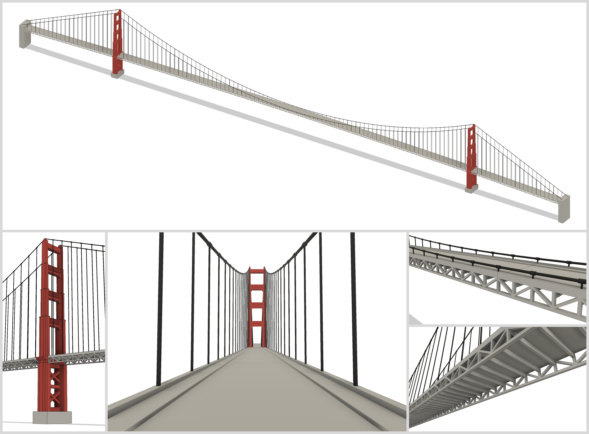

# Suspension bridge

A parametric suspension bridge in Fusion. The towers follow the Golden Gate Bridge's towers as
closely as the sources allow: portal struts with fluted faces, legs that step narrower toward the
top, X-bracing below the road, and a rounded cable saddle on each leg. The Golden Gate is the
inspiration only; its name is not used in the Fusion design.

The deck is an open truss with floor ribs, sidewalks and railing lips. Two main cables hang from
the towers, with 250 hangers 50 ft apart and a cable band at the top of each, as on the real
bridge. The cables and hangers are for looks only.

## Pictures

| Picture | What it shows |
|---|---|
| [suspension_bridge.png](pictures/gallery/suspension_bridge.png) | The whole bridge, one tower, the road, the hangers and cable bands, the deck from below |
| [02_one_tower.png](pictures/gallery/02_one_tower.png) | One tower, top to bottom |
| [1-tower-front.png](sketches/1-tower-front.png) | The 2D sketch confirmed before the first build: one tower looking along the road, towers 150 mm |

## Favorite parameters

Five favorites, in this order in Fusion's Change Parameters:

- `tower_height`: pier top to the top of the saddle. All heights and the cable sag follow from it at
  the real bridge's ratios. It goes from 133 mm to 781 mm. Not less than 133 mm: at 116 mm the tower
  splits into separate pieces, and at 82 mm the side-span hangers lose their cuts.
- `road_width`: the deck width, edge truss to edge truss. The legs and cables sit this far apart,
  so a wider road gives wider portals. It goes from 16 mm to 100 mm.
- `main_span_length`: tower to tower, centre to centre. The side spans and the road arc follow from
  it. It goes from 300 mm to 1800 mm. Default 897 mm.
- `road_clearance`: the free height above the road inside each tower, up to the first strut: room
  for a toy train. The struts above it squeeze or stretch to fit, so a shorter bridge can keep its
  tower look. It goes from 10 mm to 150 mm. Default 27.3 mm.
- `leg_thickness_share`: the leg width at its base, as a share of the tower height. Raise it for a
  lower but bulkier tower. It goes from 0.03 to 0.085. Default 0.045, about a twenty-second.

**Limits built into the formulas** (Fusion applies them on its own, without running the script):

- The leg is never wider than the road width / 1.4, so the legs always leave the road free. This
  replaces the old "keep the road at least a sixteenth of the tower" rule.
- `road_clearance` never takes more than 0.6 of the height from the road to the leg top.
- The railing lip never takes more than 0.6 of the room between the road and the cable bands at
  mid-span. A taller lip met the cable there, and the right half of the main span lost its hangers
  (found 2026-11-17, with every value at its top end).
- The anchor block is never longer than a quarter of the side span.

**Everything else is a share of its parent part,** not a size in mm. Each detail has a
`..._share` parameter: flute spacing and the ledge follow the strut height, the slab and the floor
ribs follow the truss depth, the hangers follow the cable diameter, and so on. The mm parameters
are formulas over these shares, so the whole bridge keeps its look at any size. The side span is
`side_span_share` of the main span (0.268).

**Thin parts are watched, not fixed.** A check run logs every detail thinner than 0.4 mm (one
nozzle width) for each trial, and a summary line at the end with the thinnest one.

At towers 150 mm the bridge is 1 : 1430: the road is 19 mm wide, the main span 0.90 m and the
suspended bridge 1.38 m long.

## Design rounds

Five rounds:

1. The first build of the whole bridge.
2. Tower and deck details: fluted struts, corbels, open truss sides, floor ribs, sidewalks.
3. A road block between the tower legs fills a gap in the road; plainer parameter names.
4. Side-span truss panels stretched a little so whole panels fill the span; hangers and cable bands.
5. Every size a share of its parent part; five favorites (adds main span, road clearance, leg thickness) with limits built into the formulas; thin parts watched. Rebuilt clean. The truss holes and floor ribs are now one symmetric pattern each, set to Identical: the clean build takes 102 s, down from a 295 s step alone.
   Then the top of the tower range, 781 mm, was made to build. There the road clamps the legs, so
   four things broke: the corbel step-out is now capped at a sixth of the gap between the legs, so
   the two corbels of a strut never meet; the saddle cover is sized in leg cells, so its round fits
   and it stays joined; the hangers and cable bands are trimmed by one comb body each instead of a
   list of gap blocks (fusion/rules.md rule 24); the flute spacing is capped so at least three
   flutes fit between the legs. Without that cap no whole flute fit, the row's start dimension went
   to 0, and back at 150 mm the row started at the wrong end. At 781 mm the tower and each cable
   are one body.

## Sources

The real bridge's sizes come from the Golden Gate Bridge district's
[design and construction stats](https://www.goldengate.org/bridge/history-research/statistics-data/design-construction-stats/),
the chief engineer's
[1938 report](https://archive.org/details/goldengatebridge1970gold/page/n285/mode/1up) and the
[HAER photos](https://www.loc.gov/item/ca1355/). The strut heights are read from a photo, good to
about ±10 ft. Printable models others made, looked at for which details print well:
[Golden Gate Bridge Tower 1:400](https://makerworld.com/en/models/392123),
[HUGE! Golden Gate Bridge](https://www.thingiverse.com/thing:5229824),
[Golden Gate Bridge on GrabCAD](https://grabcad.com/library/golden-gate-bridge-2).

## Files

| File | What |
|---|---|
| [build_bridge.py](scripts/fusion/BuildSuspensionBridge/build_bridge.py) | The build script: every part, every size a Fusion user parameter |
| [BuildSuspensionBridge.py](scripts/fusion/BuildSuspensionBridge/BuildSuspensionBridge.py) | The small entry file Fusion runs |
| [scripts/sketch.py](scripts/sketch.py), [scripts/sketch_details.py](scripts/sketch_details.py) | Draw the 2D sketches to confirm before a build |
| [pictures/gallery/](pictures/gallery/), [sketches/](sketches/) | The pictures above |

How the agent works in Fusion is in [fusion/rules.md](../../fusion/rules.md).
